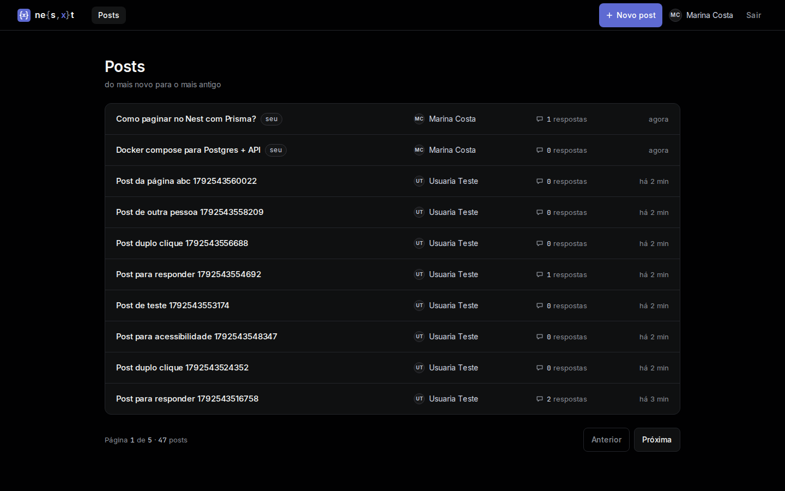
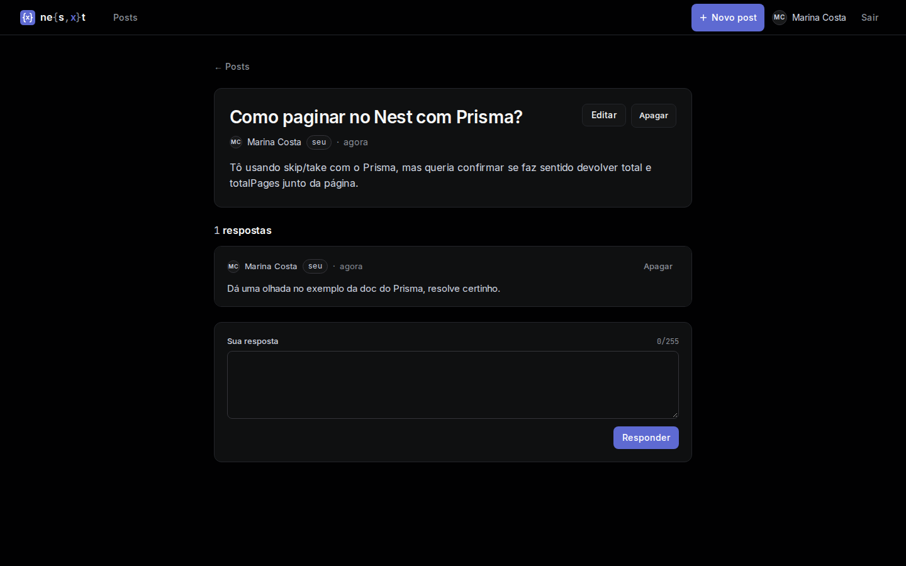
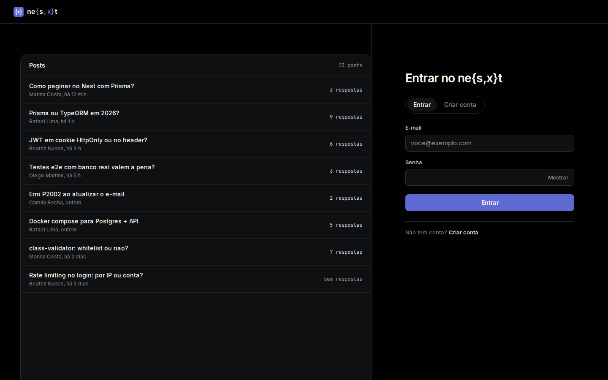

# ne{s,x}t

Front em Next.js do fórum da API [LuizDevExe/nest-api](https://github.com/LuizDevExe/nest-api).

"ne{s,x}t" lê-se mesmo "next": é o nome do Next.js escrito como se o `x` fosse opcional,
igual ao `{s,x}` de um glob de shell — tente `echo ne{s,x}t` no terminal.

## Stack

- [Next.js 16](https://nextjs.org/) (App Router, Server Actions, Cache Components/PPR) + React 19
- Tailwind CSS 4
- [Vitest](https://vitest.dev/) para testes unitários
- [Playwright](https://playwright.dev/) + [@axe-core/playwright](https://github.com/dequelabs/axe-core-npm) para e2e e acessibilidade

## Como rodar

Este front é só a camada web: ele não fala com o banco, só com a API. Para rodar os dois
juntos, suba a [API](https://github.com/LuizDevExe/nest-api) primeiro (ela tem o próprio
README com `docker compose up -d db`, `prisma migrate deploy` e `npm run start`, e por
padrão escuta em `http://localhost:3000`), e então suba o front:

```bash
cp .env.example .env.local   # API_URL=http://localhost:3000 por padrão
npm install
npm run dev                  # front em http://localhost:3001
```

O `.npmrc` fixa `legacy-peer-deps=true`: sem ele, `npm install` quebra com um bug do
arborist do npm 10 ao resolver os peers opcionais do Vitest 4.

Se a API estiver em outra porta (ex.: a 3000 já estiver ocupada), aponte `API_URL` para
ela no `.env.local`.

## Como testar

```bash
npx vitest run                              # unitários (lib/, actions, componentes puros)
npm run lint

# e2e — precisa da API rodando de verdade (os testes criam contas e posts via API):
npx playwright install chromium             # uma vez só
API_URL=http://localhost:3000 npx playwright test
```

Os testes e2e (`e2e/`) sobem o próprio front (`next build && next start` na porta 3001,
via `webServer` do `playwright.config.ts`) e falam com a API indicada em `API_URL` — a API
**não** é subida pelo Playwright, nem localmente nem no CI. Cada teste cria seus próprios
usuários (e-mail com timestamp + número aleatório), então a suíte não exige um banco vazio.

`e2e/acessibilidade.spec.ts` roda o [axe](https://www.deque.com/axe/) em `/entrar`,
`/criar-conta`, `/`, `/post/:id` e `/novo`, depois que o conteúdo (streamed via Suspense)
já carregou, e falha se houver qualquer violação.

## CI

`.github/workflows/ci.yml` sobe um Postgres de serviço, faz checkout da API
(`LuizDevExe/nest-api`, hoje na branch `front-apoio` — trocar para `master` quando os PRs
de lá forem mergeados) numa pasta `api/`, roda `prisma migrate deploy` e `node dist/main`
nela, espera `http://localhost:3000/api` responder, e só então roda `lint`, `vitest` e
`playwright test` no front. O relatório HTML do Playwright é subido como artefato quando
algum teste falha.

## Decisões

- **BFF com cookie HttpOnly.** O front nunca expõe o JWT ao navegador: `POST /entrar` e
  `POST /criar-conta` chamam a API a partir do servidor (Server Actions) e guardam o
  token num cookie `httpOnly; sameSite=lax` (`lib/sessao.ts`). Toda chamada autenticada
  (`lib/api.ts`) sai do servidor com esse cookie — client components nunca veem o token.
- **Quem garante as permissões é a API.** O front só *esconde* botões (Editar/Apagar só
  aparecem pra quem é dono, lido do `sub` do JWT) para não poluir a UI; quem de fato barra
  é a API, com 403 em qualquer PATCH/DELETE de outra pessoa. Por isso abrir
  `/post/:id/editar` do post de outra pessoa não quebra a página: ela mostra "Esse post é
  de outra pessoa." em vez de um form que nunca salvaria.
- **Sessão expirada.** Um 401 da API vira redirect para `/entrar?expirou=1`
  (`lib/api.ts`). Server Components não podem apagar cookie durante o render, então quem
  de fato apaga o cookie velho é o `proxy.ts`, na própria rota `/entrar` quando vê
  `?expirou=1`.
- **Proteção contra open redirect.** `?volta=` (pra onde voltar depois do login) só aceita
  caminhos internos (`/algo`); `destinoSeguro()` rejeita `//host`, `https://host` e
  variações com barra invertida que o navegador resolveria como absolutas, mandando pra
  `/` nesses casos.
- **Origin check em `/sair`.** `/sair` é uma Route Handler (POST), não uma Server Action —
  por isso não ganha de graça a checagem de origem que o Next faz em Server Actions. Ela
  confere `Origin` contra o host da própria requisição antes de apagar o cookie, pra um
  form de outro site não conseguir derrubar a sessão de quem o visita.

## Prints

| Lista de posts (desktop) | Post + respostas | Entrar |
| --- | --- | --- |
|  |  |  |
